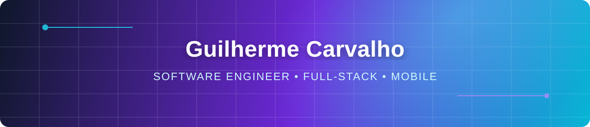

<div align="center">

<a href="https://codivatech.com">
  
</a>

[](https://git.io/typing-svg)

[](https://codivatech.com)
[](https://www.linkedin.com/in/guilherme-carvalho-bbb584215/)
[](mailto:guilherme_oliveira404@hotmail.com)
[](https://www.instagram.com/guicarvalho.dev/)

</div>

## `> whoami`

I am a **Software Engineer with a bachelor's degree from Universidade Católica do Salvador (UCSAL)**, focused on building production-ready **web, mobile, and full-stack products**. I turn business requirements into maintainable systems by combining sound engineering, thoughtful user experiences, and pragmatic technical decisions.

At [Codiva Tech](https://codivatech.com), I design and deliver custom digital solutions end to end — from technical discovery and architecture to implementation and continuous product evolution. My work is guided by clean interfaces, explicit trade-offs, performance, and long-term maintainability.

```text
Current focus  Modern web, mobile, APIs, and system integration
Core strength  Product-minded full-stack development
Education      B.Sc. in Software Engineering — UCSAL
Goal           Build useful, reliable software designed to evolve
```

## Engineering profile

- **Front end:** responsive interfaces, reusable component systems, and modern applications with React, Next.js, and Tailwind CSS
- **Back end:** business logic, REST APIs, and service integration using Node.js, Java, and Python
- **Mobile:** cross-platform application development with Flutter and native Android experience
- **Data:** relational modeling, efficient queries, and persistence with SQL and Oracle Database
- **Engineering practices:** clean code, separation of concerns, Git-based workflows, performance, and maintainable architecture

## Tech stack

<div align="center">

### Core


### Web & mobile


### Data & tooling


</div>

## Selected work

<table>
  <tr>
    <td width="33%" valign="top">
      <h3 align="center">No Roteiro</h3>
      <p align="center">A smart travel-planning platform offering personalized itineraries, local recommendations, maps, accommodations, and cultural discovery.</p>
      <p align="center"><a href="https://noroteiro.com"><strong>Explore the product →</strong></a></p>
    </td>
    <td width="33%" valign="top">
      <h3 align="center">Vivau</h3>
      <p align="center">A digital product built around a clear, responsive, and user-centered experience across devices.</p>
      <p align="center"><a href="https://vivau.com.br"><strong>Explore the product →</strong></a></p>
    </td>
    <td width="33%" valign="top">
      <h3 align="center">Consciência Colaborativa</h3>
      <p align="center">A client project that translates brand purpose and business requirements into a cohesive digital presence.</p>
      <p align="center"><a href="https://conscienciacolaborativa.com.br"><strong>View the project →</strong></a></p>
    </td>
  </tr>
</table>

## GitHub activity

<div align="center">
  
  
</div>

## Contribution graph

<div align="center">
  <picture>
    <source media="(prefers-color-scheme: dark)" srcset="https://raw.githubusercontent.com/Fiudy/Fiudy/gh-pages/github-contribution-grid-snake-dark.svg">
    <source media="(prefers-color-scheme: light)" srcset="https://raw.githubusercontent.com/Fiudy/Fiudy/gh-pages/github-contribution-grid-snake.svg">
    
  </picture>
</div>

<br>

<div align="center">
  <strong>Have a technical challenge or a product worth building?</strong>
  <br><br>
  <a href="https://codivatech.com"><strong>Discover Codiva Tech</strong></a>
  &nbsp;•&nbsp;
  <a href="mailto:guilherme_oliveira404@hotmail.com"><strong>Let's talk</strong></a>
  <br><br>
  
</div>


